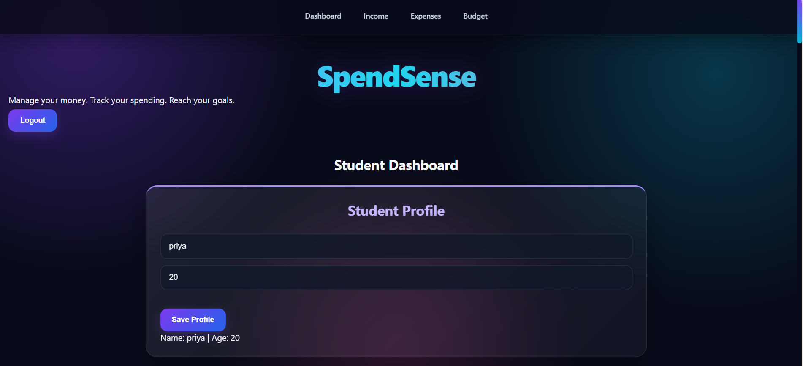

\# SpendSense – Smart Student Spending \& Budgeting System


SpendSense is a student-focused expense tracking and budgeting web application designed to help students manage their money, monitor spending habits, and achieve savings goals.


\## Features

## Dashboard Preview




\- Student registration and login

\- Student profile management

\- Income tracking

\- Expense tracking with categories

\- Monthly budget management

\- Category-wise budgets

\- Remaining balance and savings tracking

\- Savings goals

\- Upcoming expense planning

\- Spending charts and comparisons

\- Smart spending insights

\- User-specific data management


\## Technologies Used


\### Frontend

\- HTML

\- CSS

\- JavaScript


\### Backend

\- Java 21

\- Spring Boot

\- Spring Data JPA

\- Maven


\### Database

\- MySQL 8.0


\### Tools

\- Visual Studio Code

\- Git

\- GitHub


\## Project Structure


```text

SpendSense/

├── backend/

├── frontend/

├── .gitignore

└── README.md

```


\## How to Run the Project


\### 1. Clone the Repository


```bash

git clone https://github.com/Abinaya161/SpendSense.git

```


\### 2. Set Up the Database


\- Install MySQL.

\- Create a database named `spendsense`.

\- Check the database configuration in the backend application properties.


\### 3. Configure Database Password


Set the `DB\_PASSWORD` environment variable before starting the backend.


\### 4. Run the Backend


Open the backend folder in the terminal and execute:


```cmd

mvnw.cmd spring-boot:run

```


\### 5. Run the Frontend


Open `frontend/index.html` using VS Code Live Server.


\## Project Goal


The goal of SpendSense is to encourage better financial habits among students through simple expense tracking, budgeting, and savings insights.


\## Developed By


\*\*Abinaya K\*\*


B.E. Computer Science and Engineering


GitHub: https://github.com/Abinaya161

